# AVTO — dizayn tizimi (Petrol Teal + Sand)

2026-11-11 da tasdiqlangan. Joylashuv — “A variant (Yashil Pro)”, ranglar — **Petrol Teal + Sand**.
Kod: `src/cabinet/telegram/telegram.css` (o‘zgaruvchilar `:root` da).

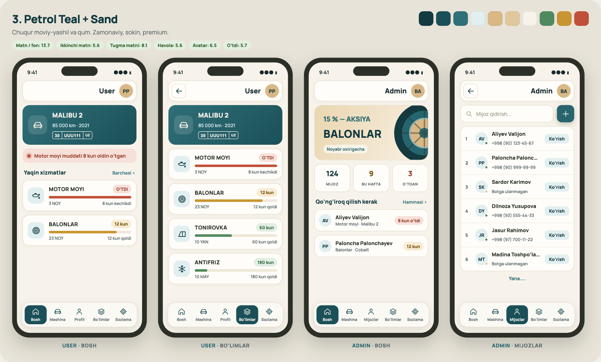

## Ranglar

| Vazifa | O‘zgaruvchi | Rang |
|---|---|---|
| Eng to‘q matn, sarlavha | `--t900` | `#123a40` |
| Asosiy (tugma, faol menyu) | `--t800` | `#1b5058` |
| Ikkilamchi tugma, “+” | `--t700` | `#26656e` |
| Havolalar | `--t600` | `#2f6f78` |
| Ikonka foni | `--t100` | `#e2eff0` |
| Fon | `--sand-bg` | `#f7f3eb` |
| Karta | `--sand-card` | `#fffdf9` |
| Chegara | `--sand-line` | `#e5dbc9` |
| Tahrirlash tugmasi | `--sand-300` | `#e0c89c` |
| Urg‘u (avatar) | `--sand-acc` | `#d9b886` |
| Asosiy matn / ikkinchi matn | `--tg-ink` / `--tg-muted` | `#17292c` / `#5a6a6c` |

Muddat holati: **yashil** `#4f8a5e` — vaqt bor; **oxra** `#c99530` — 14 kun va kamroq qoldi; **terrakota** `#c0503a` — muddati o‘tgan.
Barcha matn/fon juftliklari WCAG AA (≥ 4.5) talabiga javob beradi.

## Qoidalar

- Fon och (oq emas), to‘q rang faqat matn va tugmalarda; katta kartalar bir pog‘ona ochroq (`--t600 → --t800`).
- Shrift — Manrope. Kartalar 15–18 px radius, yumshoq soya.
- Pastki menyu: 5 ta belgi + yozuv; faol bo‘lim to‘q teal fonda.
- Avatar — ism bosh harflari; holat — rangli “pill” + progress chiziq + “N kun qoldi / kechikdi”.
- Mashina raqami: `30 │ UUU111 │ UZ` belgisi.

## Ekranlar

| | |
|---|---|
| User · Bosh 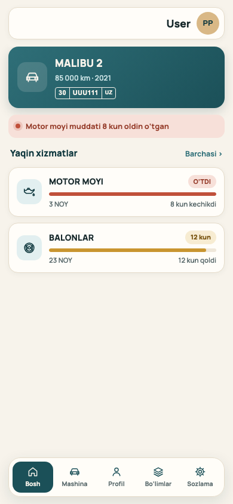 | User · Bo‘limlar 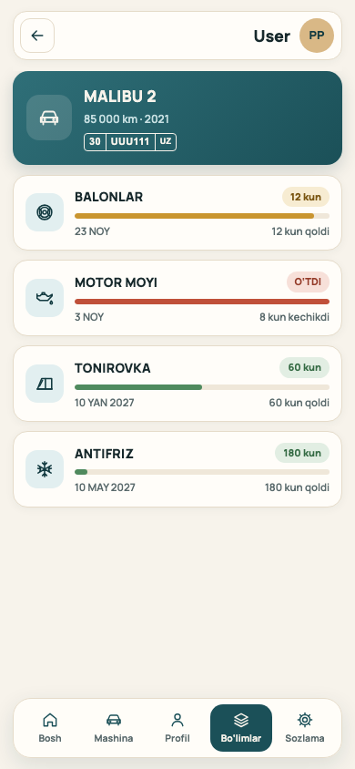 |
| User · Balonlar 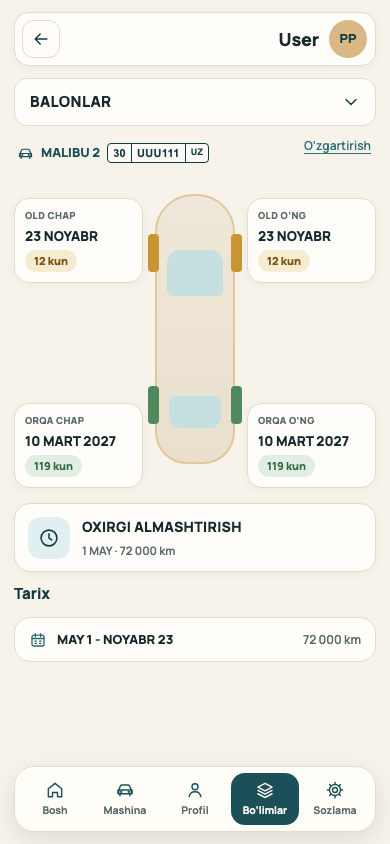 | User · Antifriz 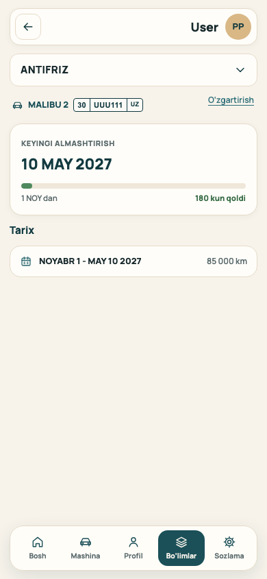 |
| User · Profil 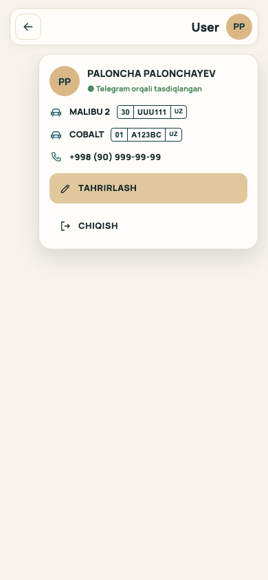 | Akkaunt yaratish 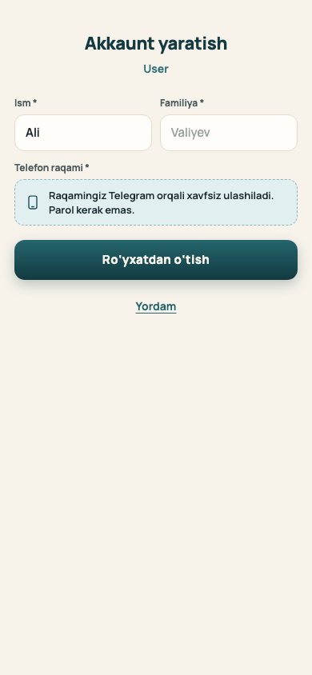 |
| Admin · Bosh 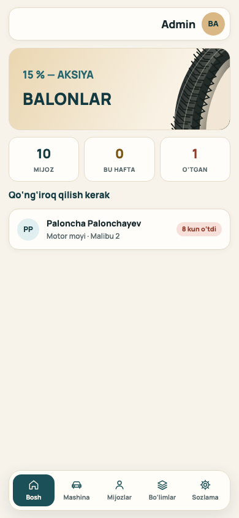 | Admin · Mijozlar 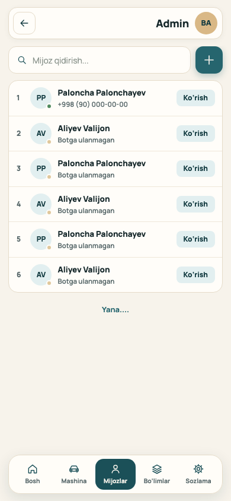 |
| Admin · Mashinalar 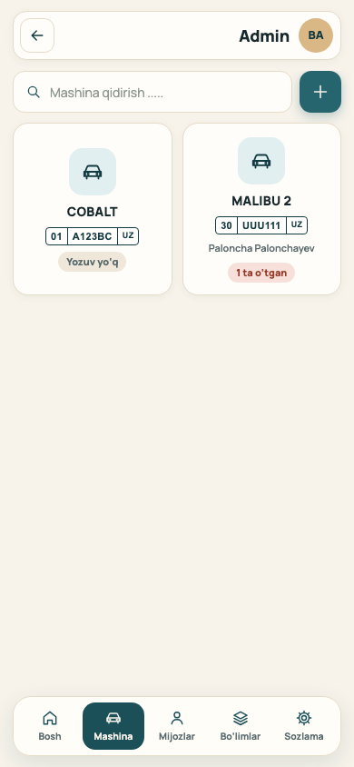 | Admin · Bo‘limlar 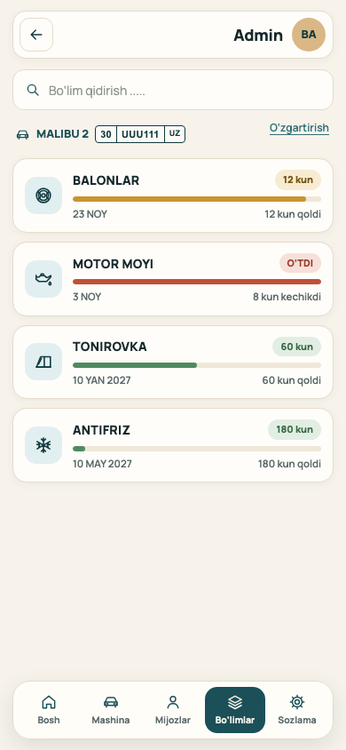 |
| Mijoz qo‘shish 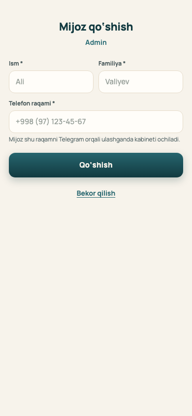 | Xizmat yozuvi 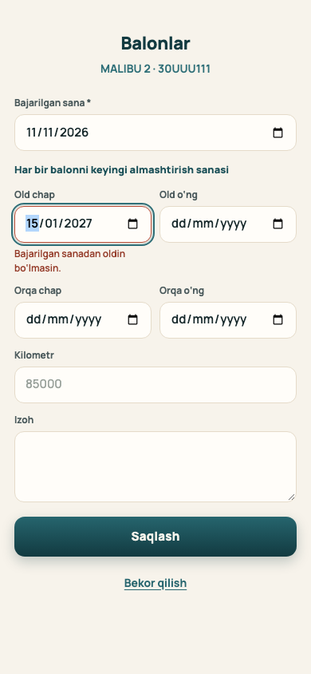 |

Ekranlar Playwright testlari vaqtida olinadi (`AVTO_SHOTS_DIR=docs/dizayn/ekranlar npm run test:telegram`). Ma’lumotlar namuna.
